# 星伴 · Starwhisper

星伴是围绕角色“浅”制作的原生 Android 陪伴 App：聊聊天、轻触人物、一起读书或安静待着，让相处状态和有来源的记忆延续到下一次打开。仓库名为 **Starwhisper**，安装后的应用名仍为“星伴”。

当前版本 **0.1.0 / r17（2026-10-26）**，处于 Debug 模拟器试用阶段。

## 当前体验

- **对话与阅读**：流式显示台词，支持停止、历史阅读和回到最新。聊天默认展开，展开选择在设置往返及可恢复重建后保持；跟随新消息使用直接滚动对齐，手动阅读时退出跟随。
- **人物与互动**：六张 2D 立绘可手选或随活动切换，配合轻微呼吸、触点光圈和短句反馈。当前使用静态立绘与轻量动画，未实现完整 3D 或 Live2D。
- **持续状态与记忆**：聊天、触摸、活动和离开时长参与本地状态规则；记忆候选绑定用户原话来源，可查看、更正或忘记。人物设定、心情规则和记忆组织由 `core` 与提示词共同实现，未进行模型微调；界面心情不代表模型拥有真实情绪。
- **时间与搜索**：当前时间取自设备墙钟和时区；明确要求联网搜索时，使用有界只读工具，最终回复附来源和查询时间。原始推理不显示、朗读或保存，也不展示“正在思考／正在查资料”等过程文案。
- **声音与音乐**：语音合成默认关闭，可选择系统 TTS 或配置 MiniMax；系统语音识别需麦克风权限。内置三首钢琴曲默认开启，初始应用音量 15%，仅前台播放，录音和朗读时让位。也可在设置中切换 QQ 音乐来源。

## 开始使用

当前试用入口为自行构建的 Debug APK，最低 Android 8.0（API 26）。构建入口见下文，安装后打开“星伴”。

1. 进入设置，在“对话服务”选择服务，填写对应 Key，点击保存后返回主页聊天。
2. 如需联网搜索，另外确认已配置 **DeepSeek 官方 Key**；选择 OpenCode Go 聊天时，搜索仍使用官方 Key。
3. 声音保持默认关闭即可文字聊天。选择系统 TTS 需要设备安装支持中文的引擎；选择 MiniMax 需要独立 Key 和有权使用的音色 ID。语音识别服务可能联网。
4. 如需 QQ 音乐控制，先安装并主动打开 QQ 音乐播放歌曲，再到星伴设置选择 QQ 音乐，并按页面提示授予系统通知访问权限。

| 对话服务 | 固定请求模型 | Key |
| --- | --- | --- |
| DeepSeek 官方 | `deepseek-flash` | DeepSeek API Key |
| OpenCode Go | `deepseek-v4.1-flash` | OpenCode Go API Key |

两家的接口和 Key 独立配置。请求启用 `thinking` 并设置 `reasoning_effort=max`，这是发送给供应商的请求配置；失败不会自动重试或切换服务。缺少对应 Key 时会提示配置。页面用量和参考费用不等于实际账单，在线服务费用以供应商为准。

## 有限手机命令

仅**当前用户输入的整句有限命令**能触发手机动作；模型回复、网页、记忆和历史消息不能发起动作。例如：

| 输入示例 | 当前行为与条件 |
| --- | --- |
| `播放QQ音乐`、`暂停QQ音乐`、`上一首`、`下一首` | 调用 QQ 音乐的系统媒体会话；需通知访问、活跃会话及对应操作支持。 |
| `QQ音乐音量30%` | 按当前输出目标调整绝对音量。本机目标是“手机播放音量（系统共享）”；远端目标是播放设备音量，取决于平台能力。 |
| `打开QQ音乐` | 向系统移交打开请求。 |
| `设置8点30分闹钟` | 向系统时钟提交设置请求，实际闹钟状态需在时钟 App 中确认。 |

QQ 音乐页面显示系统会话提供的曲目信息与队列；未提供队列时会明确说明。切换为 QQ 音乐来源会停止星伴的本地背景播放器。真实 QQ 音乐实播尚未验证，当前能力不覆盖任意手机操作或全自动控制。

## 代码与开发

| 模块 | 职责 |
| --- | --- |
| [`core`](core/src/main/kotlin/cn/xingban/core) | 纯 Kotlin：角色与心情规则、活动、来源记忆、上下文和提示词组织、有限命令解析。 |
| [`app`](app/src/main/java/cn/xingban/app) | Android / Jetpack Compose：界面与 ViewModel、Room 本地快照、Keystore 凭据、流式服务、只读工具、语音和系统媒体／手机接口。 |

当前构建配置要求 JDK 21 工具链，使用 Gradle 8.13、Android SDK Platform 36 / Build Tools 36.0.0；Android Gradle Plugin 为 8.11.1，Kotlin 为 2.2.21，字节码目标为 Java 17。准确版本以 [`build.gradle.kts`](build.gradle.kts)、[`app/build.gradle.kts`](app/build.gradle.kts) 和 [`core/build.gradle.kts`](core/build.gradle.kts) 为准。

项目使用 [`scripts/Build.ps1`](scripts/Build.ps1)，当前没有 Gradle Wrapper。准备好本机已有的 JDK、Android SDK 与 Gradle，并将三个环境变量分别指向安装目录后，在项目根目录执行：

```powershell
.\scripts\Build.ps1 `
  -JavaHome $env:JAVA_HOME `
  -AndroidSdk $env:ANDROID_SDK_ROOT `
  -GradleHome $env:GRADLE_HOME `
  -Tasks ':core:test', ':app:testDebugUnitTest', ':app:assembleDebug'
```

构建使用模块默认的 `build/` 目录，Debug APK 位于 `app/build/outputs/apk/debug/app-debug.apk`。脚本默认任务还包含隔离 fixture 及其测试 APK；上面的显式任务只运行 JVM 检查和 Debug 构建。设备测试、真实 API 请求和 Release 发布有各自的运行条件，不由这条命令代替。

旧 3D 技术样例与无消费者资源已从当前源码和打包输入中移出；当前人物展示使用六张 2D 立绘。

## 架构与流程

从 [`架构说明`](docs/ARCHITECTURE.md) 或 [`五视图导航`](docs/architecture/index.html) 进入。SVG 可直接预览；HTML 请下载后在浏览器打开，GitHub 文件页不执行 HTML；JSON 是可编辑图源。



| 视图 | 预览 | 离线浏览 | 可编辑源 |
| --- | --- | --- | --- |
| 模块、依赖与责任 | [SVG](docs/architecture/xingban-architecture.svg) | [HTML](docs/architecture/xingban-architecture.html) | [JSON](docs/architecture/candidate.json) |
| 聊天回合 | [SVG](docs/architecture/chat-turn.svg) | [HTML](docs/architecture/chat-turn.html) | [JSON](docs/architecture/chat-turn.json) |
| 时间与只读搜索 | [SVG](docs/architecture/read-only-tools.svg) | [HTML](docs/architecture/read-only-tools.html) | [JSON](docs/architecture/read-only-tools.json) |
| 手机动作与音频 | [SVG](docs/architecture/phone-audio.svg) | [HTML](docs/architecture/phone-audio.html) | [JSON](docs/architecture/phone-audio.json) |
| 存储与记忆 | [SVG](docs/architecture/storage-memory.svg) | [HTML](docs/architecture/storage-memory.html) | [JSON](docs/architecture/storage-memory.json) |

## 数据、备份与隐私

聊天、人物状态、记忆和普通设置保存在设备本地 Room 快照。API Key 使用 Android Keystore 保护的加密存储，彼此独立，不随 JSON 备份导出。在线聊天、搜索和 MiniMax 合成会向对应供应商发送相关输入；本地保存不等于所有功能离线运行。

设置页可导出或恢复 JSON 备份。备份含私人聊天和记忆，请自行保管；恢复有效备份会替换当前聊天、心情、记忆和普通设置，保留本机 Key 与本机已发生用量，格式错误的文件不会覆盖原数据。“忘记”让相应记忆退出未来上下文，原聊天和已导出的旧备份仍然保留。

## 已验证范围

r17 已有 **63 项聚焦 JVM 检查、6 个隔离模拟器方法、3 个使用真实服务的隔离 App 链路样本**的通过记录。三个真实样本合计执行 5 次模型请求和 1 次官方搜索，覆盖官方聊天、Go 设备时间工具及带来源搜索。Debug APK 已在模拟器运行并确认主页就绪。

这些结果只覆盖所列检查和样本。当前未完成真机、Release、真实 QQ 音乐实播与真实语音听感验证；没有帧率测量或“所有卡顿已消除”的结论，也不保证长期记忆语义或每次模型输出都正确。

## 素材与许可

内置三首钢琴曲来自 Kevin MacLeod，署名、CC BY 4.0 许可与逐曲来源见 [`音频署名`](assets/audio/ATTRIBUTION.md) 和 [`来源清单`](assets/audio/music-sources.json)。

项目代码当前用于公开展示，尚未指定统一的代码许可证；第三方素材的许可不自动覆盖项目代码。
